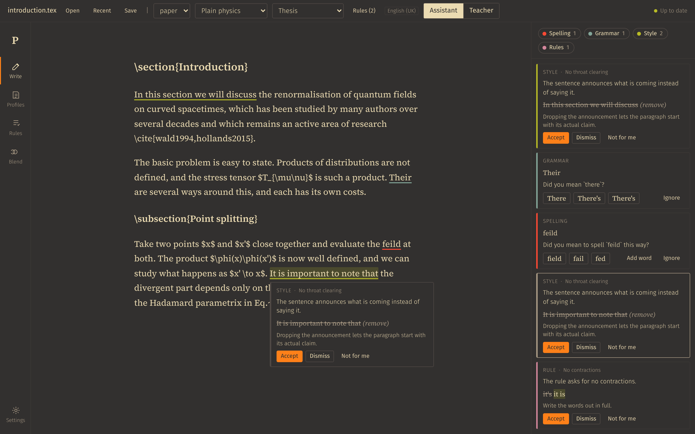
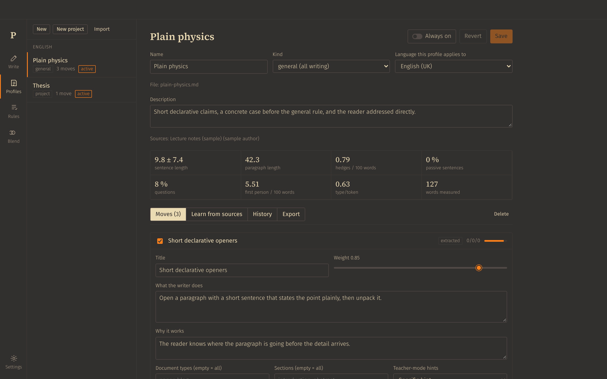
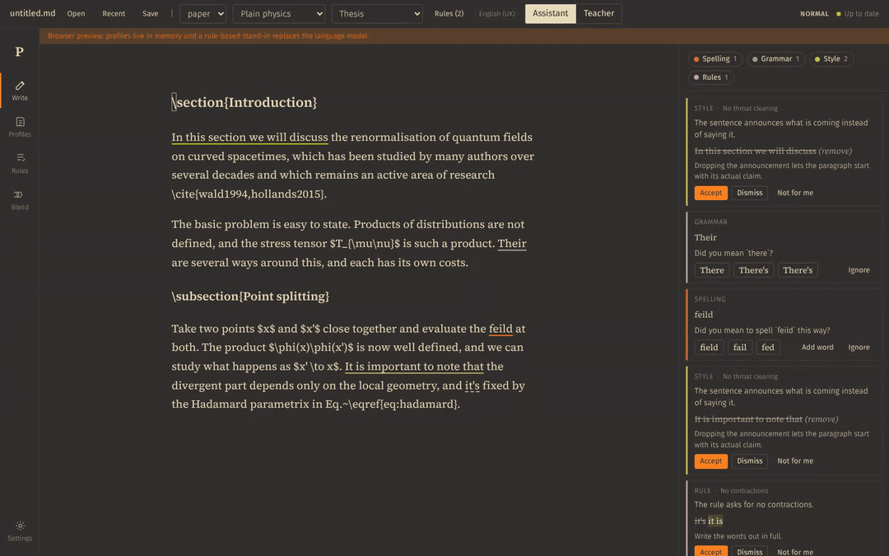
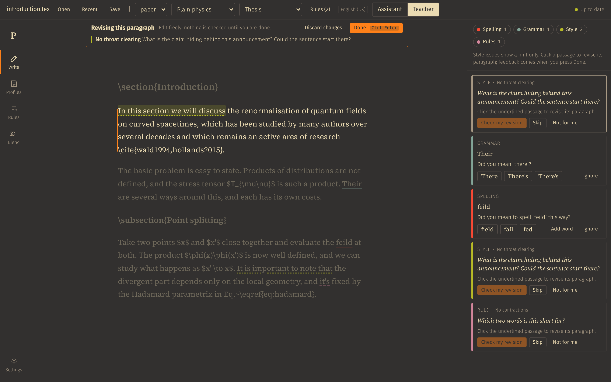
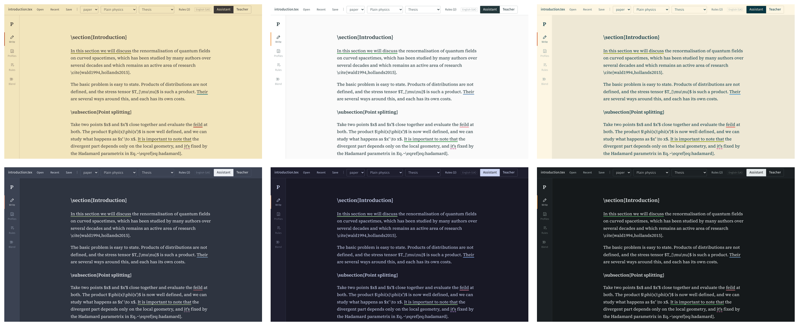

  

<h1 align="center">Phaedrus</h1>

  A grammar checker and style coach for papers, theses and books, trained on the writers you like.

  
  

Phaedrus is a desktop editor for long-form writing. Open the `.tex` or `.md` file you are working on, and it checks spelling, grammar and style in place, then saves back to the same file. Style suggestions come from authors you choose, so your prose gets closer to theirs instead of drifting toward the flat register most grammar tools push everyone into.

## Your style, your rules

Phaedrus ships with no house style. You build one from texts you already admire: add PDFs, EPUBs, LaTeX or Markdown, and the model extracts 6 to 14 concrete moves, such as "open a paragraph with a short sentence that states the point". Each move has a weight, a scope (paper, thesis, the introduction only) and examples from the source. Profiles are plain Markdown files, so you can edit them by hand, blend two at 70/30 and keep them under git.

Rules work the same way for requirements: paste a journal's author guide or your supervisor's comments, and Phaedrus turns them into checkable rules with their own underline colour. The one built-in rule set flags common signs of AI writing. You can switch it off, edit it or delete it.

## Use the subscription you already have

Phaedrus needs no API key. If you are signed in to the Claude Code or Codex CLI through a Claude or ChatGPT subscription, it runs its checks through that login and never reads the tokens. An Anthropic key or any OpenAI-compatible endpoint works too, including a local Ollama. Check your provider's terms before relying on a subscription for this; the [guide](docs/README.md#language-model) has the details.

## Vim keys throughout

Turn on vim mode and the editor and the rest of the app become modal. `Tab` jumps to the next underline, `1` to `9` pick a replacement, Enter accepts, `x` dismisses. Everything else sits under a Space leader menu that shows the next keys as you type, and `jk` can stand in for Escape.

## LaTeX and Markdown math

Math, citations, labels and comments are masked before any check runs, so `$T_{\mu\nu}$` is never a spelling mistake and `\cite{wald1994}` never confuses the grammar engine. Section commands give the style checks their section name. A rewrite that does not keep every equation and reference of the passage word for word is discarded before you see it.

## Teacher mode

In teacher mode a style issue shows only a hint, a question that points at the problem. You revise the paragraph yourself while the rest of the page dims. When you press Done, the model judges whether your revision landed. As you get it right, the hints become less explicit.

## Themes

Eleven themes, plus one that follows your system, each with its own underline colours: Gruvbox in four variants, Solarized and Catppuccin in light and dark, Nord, and a plain Light and Dark.

## Install

Download the installer for your system from the [releases page](https://github.com/I-am-Rudi/phaedrus/releases): `.dmg` for macOS, `.exe` for Windows, `.AppImage` or `.deb` for Linux. The builds are not signed yet, so macOS and Windows warn on first launch.

Then:

1. Sign in to Claude Code or Codex, or enter an API key, in Settings.
2. Pick a spelling engine. Harper runs inside the app (English only); LanguageTool covers 31 languages and runs as a local server with one `docker run`.
3. Open a file and go to Profiles > Learn from sources to build your first profile.

## Documentation

- [User guide](docs/README.md): modes, taste profiles, rules, LaTeX handling, every vim key, file handling.
- [Development](docs/development.md): building from source, releases, code layout.

## License

Phaedrus is free software under the [GNU Affero General Public License 3.0](LICENSE) or later: anyone may use, study, change and share it, and whoever distributes a changed version, or runs one as a service for others, has to publish its source under the same license. Every feature described here will stay free and open source. If paid extras come later, such as a bundled model for people without a subscription, they will be additions; nothing on this page will move behind a paywall.

Copyright (C) 2026 Rudi Siebert. Third-party material and its licenses are listed in the [user guide](docs/README.md#third-party-material).
