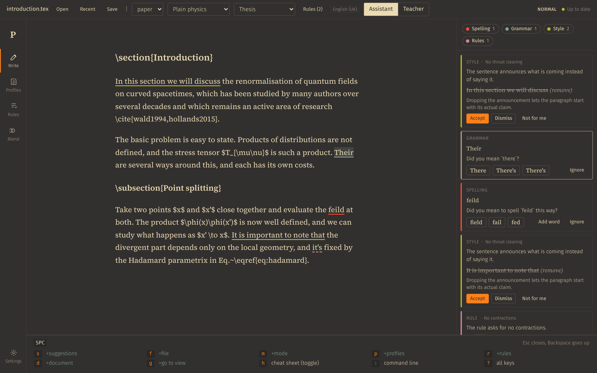
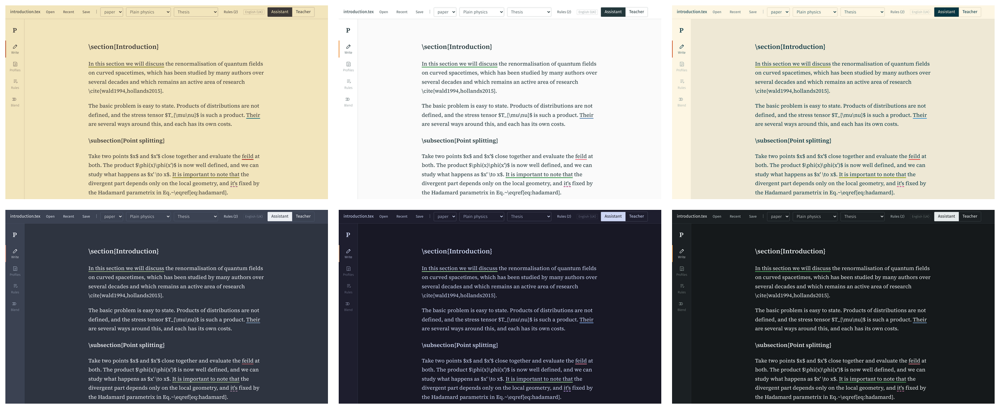

# Phaedrus user guide

How each part of Phaedrus works, in more detail than the [project page](../README.md). Developer notes (building, releases, code layout) are in [development.md](development.md).

- [Language model](#language-model)
- [Spelling and grammar](#spelling-and-grammar)
- [Documents](#documents)
- [Modes](#modes)
- [Taste profiles](#taste-profiles)
- [How the profile learns](#how-the-profile-learns)
- [Rules](#rules)
- [LaTeX and Markdown math](#latex-and-markdown-math)
- [Vim keybindings](#vim-keybindings)
- [Appearance](#appearance)
- [Third-party material](#third-party-material)

## Language model

Pick one in Settings.

| Provider | What it runs | Setup |
|---|---|---|
| Claude subscription | `claude -p --output-format json --model <model>` | Install [Claude Code](https://docs.claude.com/en/docs/claude-code), then *Sign in* in Settings or run `claude auth login` |
| ChatGPT subscription | `codex exec --sandbox read-only --output-last-message <file> -` | Install the Codex CLI, then *Sign in* or run `codex login` |
| Anthropic API | Messages API | API key; models default to `claude-haiku-5-5` for checks and `claude-sonnet-5-5` for extraction |
| OpenAI-compatible | `/chat/completions` | Base URL, key and model names; works with OpenAI, OpenRouter, Groq and a local Ollama |

The CLI providers run in an empty folder (`<userData>/cli-sandbox`) so that no project `CLAUDE.md` or files end up in the prompt. They use your existing CLI login and never read its tokens. Check each provider's terms before relying on a subscription for this kind of use. API keys are encrypted with the OS keychain through Electron `safeStorage` when available.

Style and rule checks use the fast model. The paragraph at the cursor is checked first and on its own, so the first hint arrives quickly; the rest go up to five paragraphs per request (one CLI start or API call covers several), with three requests in parallel for the CLIs and four for the APIs. Paragraphs that are waiting get a grey bar in the left margin and the ones being checked an orange one; the status bar and the panel show how many are done and how long the last request took. Settings > Send a test prompt reports the round-trip time.

The Claude CLI is called lean but with your normal login: `--system-prompt` replaces Claude Code's own prompt, `--tools ""` turns off its tools, `--strict-mcp-config` with an empty `--mcp-config` keeps your MCP servers from starting, `--disable-slash-commands` and `--setting-sources project` skip skills, hooks and plugins, and `--no-session-persistence` keeps the calls out of your session history. (`--bare` would be faster still but needs an API key.) If an older CLI rejects these flags, Phaedrus falls back to a plain `claude -p` call. Results are cached by paragraph text, document type, section and the profile's move descriptions, so accepting a suggestion (which changes weights only) does not recheck the document.

## Spelling and grammar

- **LanguageTool** (default; English, German and about 30 more languages). Run a local server:
  ```bash
  docker run -d -p 8081:8010 erikvl87/languagetool
  ```
  Nothing leaves your machine. Its style-category rules are skipped; the profile owns style.
- **Harper** runs inside the app (WebAssembly), English only, with British, American, Canadian or Australian spelling. No server needed.

Words in the Settings dictionary are never flagged as misspelled.

### How spelling corrections are ranked

The engines find misspellings well but rank corrections by how many letters differ, so for "zou" Harper offers "zoo" before "you". Phaedrus re-orders the list, and adds words the engine missed:

- **Common words first.** Each language has a list of its 40,000 most frequent words, and "you" is far more common than "zoo".
- **Your keyboard.** A neighbouring key, two swapped letters, a doubled letter or a letter two places off ("fomr" for "from") are likely slips; a key on the other side of the keyboard is not. On a German keyboard used as if it were a US one, y and z trade places, so "zou" is a cheap slip for "you". The layout is detected; Settings > Spelling and grammar > Keyboard sets it by hand.
- **Words you already use.** A word used elsewhere in the document comes first for a near miss, so "Hadamrd" becomes "Hadamard" once the document uses "Hadamard" consistently.
- **Your earlier choices.** A correction you picked comes first the next time the same typo turns up, and a slip you keep making counts as cheap for other words too. Settings shows how many are remembered and can forget them.
- **The sentence, when it is a close call.** When two corrections are about equally likely ("fomr": from, form or for), the paragraph's style check also asks the model which one the sentence needs. This only happens when the paragraph gets a style check anyway, so it costs no extra request; without a profile or rule set the order stays as above.

Words added from the frequency list are only offered if the spelling engine accepts them, since such lists also contain common misspellings like "teh". On Peter Norvig's spelling test sets from the Birkbeck corpus, the intended word came first for 80 to 84% of Harper's findings, against 70 to 71% in Harper's own order (`tests/spelling-eval.test.ts`).

A word the engine does not know stays flagged even when you use it throughout the document, because a misspelling used consistently would disappear too. Add such words to the dictionary.

## Documents

The editor opens and saves `.md`, `.txt` and `.tex` as plain text, in place, like any text editor. Formatting markup stays as literal text.

| | Keys | Vim command | Leader |
|---|---|---|---|
| Open | `Ctrl/Cmd+O` | `:e` or `:e ~/path/file.tex` | `SPC f o` |
| Open recent | File menu, Recent button | `:recent` | `SPC f r` |
| Save | `Ctrl/Cmd+S` | `:w` | `SPC f s` |
| Save as | `Ctrl/Cmd+Shift+S` | `:saveas [name]` | `SPC f a` |
| Reload from disk | File menu | `:e!` | `SPC f R` |

The last document opens again when the app starts (Settings > Checking turns this off). The asterisk after the file name means the text differs from the file; undoing back to the saved text clears it. Windows line endings are kept.

Nothing is thrown away without asking. Opening another file, quitting or closing the window with unsaved text asks *Save*, *Don't save* or *Cancel* (the letter picks the button, Enter the highlighted one, Escape cancels). Leaving Settings, a profile or a rule set with unsaved changes asks the same, and `Ctrl/Cmd+S` or `:w` saves whatever the current view edits.

Phaedrus watches the open file. When another program changes it (vim, `git pull`, a LaTeX tool) and you have no unsaved edits, it reloads quietly, keeping the cursor and scroll position. With unsaved edits it asks whether to load the version on disk or keep yours. Saving also checks the file first, so a change it missed is not overwritten without asking.

On macOS the window has no separate title bar: one bar runs across the whole window, with the window buttons at its left and the Write toolbar after them, and it moves the window. The toolbar never wraps. As the window narrows it drops the status text and the language tag, shortens Assistant and Teacher to A and T, narrows the menus, and finally hides Recent (still in the File menu and `:recent`); past that it ends in an ellipsis.

A paragraph is what TeX and Markdown mean by one: the lines up to the next blank line. Single line breaks inside it (one sentence per line, or a hard wrap at 80 columns) are source formatting, so every check reads the paragraph as one piece of text and a sentence that runs over several lines is still one sentence. The line breaks stay where they are in the editor and in the saved file.

A file counts as LaTeX by its `.tex` extension, or when it contains `\documentclass`, `\begin{document}` or several `\section` lines. In LaTeX, `#` is not a heading, and a sectioning line (`\part` to `\paragraph`, with an optional `\label` and comment) is its own block even with no blank line before the following text. It is shown like a heading and gives its title to the style checks as the section. The whitespace between blocks is kept exactly, so a file you open and save without edits comes back byte for byte.

## Modes

Both modes underline issues in the text in four colours: red for spelling, blue for grammar, green for style and purple for rules. Click an underline (or press `z=` with vim keys) to get the suggestion right there, with the same actions as the side panel, which lists every suggestion. Spelling and grammar behave the same in both modes. The chips at the top of the panel (or `SPC t` with vim keys) hide a whole category, both its cards and its underlines, until you turn it back on.

- **Assistant** shows each style suggestion in full: what drifts from the move, a rewrite of the quoted passage, and why. *Accept* applies the rewrite, *Dismiss* hides it, *Not for me* hides it and records your reason as a note on the move.
- **Teacher** shows only a hint (a question that points at the problem) with no rewrite. Click a flagged passage (or open it with the vim keys) to revise its paragraph: everything else is dimmed, edits and the cursor stay in that paragraph, and a bar above the page shows its hints. Nothing is sent while you write. *Done* (`Cmd/Ctrl+Enter`, Enter in vim normal mode, `:done`, `SPC s c`) asks the model to judge each changed passage as *landed*, *partly*, *overcorrected* or *missed* and say why; *Discard changes* (`:discard`, `SPC s x`) puts the paragraph back. Moving the cursor never triggers feedback. In vim normal mode Enter also closes the newest feedback card (when the cursor is not on a suggestion), as does `SPC s f`.
- **Text and panel are linked:** clicking a card scrolls its passage into view and puts the cursor on it; opening a passage in the text (click, `K`, Tab) scrolls its card into view. Both flash briefly so the eye finds them.

## Taste profiles

A profile has a general or project kind. In the write view you pick one of each; a project move overrides a general move with the same id. Each move has:

- a title, a description of what the writer does, and why it works
- a weight from 0 to 1, an on/off switch, and a lock
- a scope: document types (paper, thesis, blog, email, notes) and section names (matched against Markdown headings and LaTeX `\section{}`); empty means everywhere
- a teacher-mode hint level, author excerpts, your own example sentences, and notes

The profile view also offers:

- **Learn from sources** (a tab in every profile; a new, empty profile opens on it): paste text or add files (PDF, EPUB, Markdown, plain text, LaTeX), and the model proposes 6 to 14 moves. Text is pulled from PDFs with pdf.js (paragraphs rejoined, hyphenation undone, title and author from the metadata) and from EPUBs chapter by chapter in reading order. A scanned PDF has no text layer, so it goes to the model to read instead: the Claude CLI reads the file itself, and the Anthropic API takes PDFs up to 32 MB. Other providers show a note asking for the text. Measured features of the sources (sentence length and spread, hedges per 100 words, passive share, questions, first person) are stored with the profile. Style checks use them to point out measurable drift.
- **Add to profile** or **Re-extract and compare**. Adding keeps every move the profile has and offers only the new ones; moves the profile already covers are listed unticked, in case you want them anyway. Re-extracting shows a diff of added, changed and missing moves with checkboxes; merging keeps weights, scopes, locks, notes, hint levels and your own examples, and only descriptions and author excerpts change.
- **Blend**: combine profiles with weights (say 70/30). Move weights are scaled by each profile's share. Moves with overlapping titles are listed for you to keep one, keep both or merge; a second pass asks the model for contradictions between differently named moves. The Blend view also combines rule sets (see Rules).
- **Export** as a single `.md` or a `.zip` bundle with a sources list. Choose to keep all author excerpts, only those of 25 words or fewer, or none. Your own example sentences are always included.

### Languages

Every profile has a language. A project profile's language is the document language; a general profile's language says which writing it applies to. Profiles are grouped by language, and matching uses the base language, so an `en-GB` profile applies to `en-US` text but never to German.

The document language comes from the active project profile, or from the default in Settings. Only general profiles in that language (or with no language) are offered, and the choice is remembered per language. Extraction uses the profile's language, and blending combines profiles of one language only.

Spelling and grammar follow the same language: LanguageTool checks it with its rules for that language (31 languages, with deep coverage for English, German, French, Spanish, Portuguese, Dutch, Catalan and Ukrainian), and Harper checks English only, picking British, American, Canadian or Australian spelling from the language code. Style rewrites stay in the paragraph's language. The measured hedge, passive and first-person rates use English word lists; sentence length works for any language.

### File format

Profiles are plain Markdown in the profiles folder (Settings). Hand-written files without settings blocks are read too; missing values get defaults.

````markdown
---
phaedrus: 1
id: plain-physics
name: Plain physics
kind: general
language: en-GB
description: Short declarative claims, a concrete case before the rule.
sources:
  - title: Lecture notes
    author: R. Feynman
metrics: { sentenceLengthMean: 9.8, sentenceLengthStd: 7.4, ... }
---

# Plain physics

## Short declarative openers

```yaml
id: short-declarative-openers
enabled: true
weight: 0.85
locked: false
hint_level: 3
origin: extracted
scope:
  doc_types: []
  sections: [introduction]
stats: { accepted: 4, rejected: 1, landed: 2, missed: 0, streak: 2 }
```

Open a paragraph with a short sentence that states the point, then unpack it.

### Why it works

The reader knows where the paragraph is going before the detail arrives.

### Examples

> Nature is simple.
>
> Source: Lecture notes

> The integral diverges.
>
> Source: me

### Notes

- too blunt for abstracts (in paper)
````

## How the profile learns

Every profile update is saved, and the previous version goes to `.history/<profile>/` for rollback.

| Event | Effect on the move |
|---|---|
| Accept (assistant) | weight rises by 5 % of the remaining headroom |
| Not for me | weight drops by 10 %, your reason is added as a note the model sees in later checks |
| Revision landed (teacher) | after 3 in a row the hints get one level less explicit (specific question, general pointer, underline only, silent) |
| Revision missed or overcorrected | hints become more explicit again |
| Landed revision the model rates as exemplary | your sentence is kept as an example of the move (at most 5 of your own) |

Locked moves never change automatically. That covers re-extraction too.

## Rules

Rules are a second, separate category next to the taste profile: explicit requirements such as "define acronyms at first use", "no contractions" or "SI units with a thin space". A taste profile describes how authors you admire write; a rule set says what your text must do. Violations get their own dashed underline and their own "Rules" chip, and appear in the same popover and panel as style suggestions, with a rewrite in assistant mode and a hint in teacher mode.

- **Writing rules:** the Rules view lists rule sets (grouped by language). Each rule has a statement, Do and Don't examples, a scope (document types, sections), notes and a lock.
- **Extracting rules:** paste or add documents (PDF and EPUB included) that state rules, such as a journal's author instructions, a style guide or a supervisor's comments. The model extracts only rules those documents state, each checkable on a paragraph, and you pick which to add; duplicates of existing rules are skipped. *Re-extract and compare* instead lists new, changed and no longer found rules against the set, and merging keeps each rule's on/off state, lock, scope, notes and counts.
- **Blending rule sets:** the Blend view combines several rule sets of one language into a new one. Rules have no weights, so each is taken once; a rule that says the same as one from an earlier set is listed, and you can keep both.
- **Active per project:** several rule sets can be on at once, and the choice is remembered per project profile (Rules picker in the toolbar, `:rule NAME`, or `SPC r t`).
- **Always on:** the *Always on* switch on a rule set (Rules view) or a taste profile (Profiles view) checks it in every document in its language, with nothing to pick in the editor. Always-on profiles add their moves to the chosen general and project profiles, which win where a move id is shared. The toolbar shows them as "always on".
- **Built in: Signs of AI writing.** Phaedrus ships an English rule set of 20 patterns that make prose read as machine-written: not-X-but-Y contrasts, closers that repeat the point, staged run-ups, answers to objections nobody raised, triads for rhythm, dashes as all-purpose connectors, stacked hedges, overused words (delve, leverage, pivotal, tapestry...), inflated significance, promotional language, borrowed authority, filler openers, empty intensifiers, chatbot residue and others. It is paraphrased from Wikipedia's [Signs of AI writing](https://en.wikipedia.org/wiki/Wikipedia:Signs_of_AI_writing) (WikiProject AI Cleanup, CC BY-SA 4.0). It is put into the rules folder on first start and is always on; switch it off, turn off single rules, or edit them like any other set. Notes keep it from flagging precise uses in technical writing (a robust estimator, statistically significant, the energy landscape, `--` as an en dash in LaTeX). Deleting it is respected: it is not added back.
- **Checking:** rules go into the same model request as style, so they add no extra call. "Not for me" on a rule adds your reason as a note the model sees next time; rules never fade or lose weight.
- **Files:** `<profiles folder>/rules/<id>.md`, Markdown with one `## Rule` section each (settings block, rule text, `### Do`, `### Don't`, `### Notes`), with snapshots in `rules/.history/`.

## LaTeX and Markdown math

All checks treat LaTeX as markup, not prose. Before spelling and grammar run, each paragraph is turned into plain prose with a map back to the original characters:

| In the text | Checked as |
|---|---|
| `$..$`, `\(..\)`, `$$..$$`, `\[..\]`, `equation`/`align`/`gather`/`multline` environments | the placeholder word `X` |
| `\emph{..}`, `\textbf{..}`, `\section{..}`, `\caption{..}` and similar | their argument |
| `\ref`, `\eqref`, `\cref` | `1` |
| `\citet`, `\textcite` | an author name |
| `\cite`, `\label`, `\footnote`, other commands, `%` comments, `verbatim`/`tikzpicture`/`tabular` environments | removed |
| `\%` `\$` `~` ` `` ` `''` | `%` `$` space `"` `"` |

A removed citation takes the space before it along when punctuation follows, so "as in `\cite{x}`." is checked as "as in." and not flagged for a space before the full stop. Findings that touch a placeholder or markup are dropped; the rest are placed on the original text. A `$` only opens math under pandoc's rule (no space after the opening `$`, none before the closing one, no digit right after it), so "costs $5 and $10" stays prose. Eq, Fig, Sec, Ref and similar abbreviations are never flagged.

Style checks see the original paragraph and are told to leave math, commands and comments untouched. A suggestion whose rewrite does not keep every equation and reference of the quoted passage verbatim is discarded, and paragraphs that are mostly equations are skipped. Metrics are measured on the prose, and extraction sources keep inline math but show displayed equations as `[equation]`, with each paragraph joined onto one line.

## Vim keybindings

Turn them on in Settings > Keys. The editor becomes modal, the rest of the app follows the same habits, and `?` shows every key.



**Suggestions take one key.** `Tab` and `Shift-Tab` jump to the next or previous underline and show its suggestion in the text; `K` (or Enter on an underline) shows the one under the cursor. While a suggestion is shown, single keys act on it: Enter accepts (in teacher mode it checks your revision), `1` to `9` pick a replacement, `x` dismisses, `r` says not for me, `+` adds the word to the dictionary, `Tab` moves on, Esc closes. Any other key closes it and does what it normally does. Vim's own spell keys `]s [s z= zg` work as well.

**Everything else is under Space**, in a menu that lists the next keys as you go (Backspace goes up a level):

| Keys | Menu |
|---|---|
| `SPC s` | suggestions: next, previous, open, accept, dismiss, not for me, check revision, add word, focus panel, recheck |
| `SPC f` | file: save, open |
| `SPC m` | mode: toggle, assistant, teacher |
| `SPC p` | profiles: choose general or project profile, edit, extract, blend |
| `SPC r` | rules: toggle a rule set for this project, edit rule sets |
| `SPC t` | toggle suggestion types: `s` spelling, `g` grammar, `y` style, `r` rules, `a` show all |
| `SPC d` | document: type, recheck |
| `SPC g` | go to a view |
| `SPC h` | a small cheat sheet of the most-used keys, kept open while you write |
| `SPC :` `SPC ?` | command line, full key list |

**Editing** has normal, insert, visual and visual-line modes with counts; motions `h j k l w b e W B E 0 ^ $ gg G { } f t F T ; , / ? n N`; operators `d c y` with motions, doubled for lines, or with the text objects `iw aw iW aW is as ip ap`; and `x X D C s S r J ~ p P u Ctrl-r i a I A o O Ctrl-d Ctrl-u zz`. `j` and `k` move by wrapped screen lines. Yanks also go to the system clipboard.

**Escape, remapped:** Esc and `Ctrl-[` always work, `Ctrl-c` too unless you turn it off, and Settings > Keys takes an insert-mode sequence such as `jk` or `jj` with a timeout, like `inoremap jk <Esc>` and `timeoutlen` in a vimrc. Caps Lock mapped to Escape in the OS arrives as a real Escape.

**Elsewhere:** `Ctrl-w l` focuses the suggestion panel (`j`/`k` move, Enter accepts) and `Ctrl-w h` returns. `gt`/`gT` cycle the views. Outside the editor, `j`/`k`/`gg`/`G` move focus between controls, Enter opens list items, `i` returns to the editor. The `:` command line takes `:w`, `:e`, `:teacher`, `:assistant`, `:profile NAME`, `:project NAME`, `:set doctype=thesis`, `:toggle spelling` (or `grammar`, `style`, `rules`, `all`), `:check`, `:set novim` and the view names.

In the desktop app Ctrl+W and Ctrl+R are left to the page, so they reach vim instead of closing or reloading the window; reload is on F5.

## Appearance

Settings > Appearance offers System (follows the OS light or dark setting), Light, Dark, Gruvbox light soft, Gruvbox light, Gruvbox dark soft, Gruvbox dark, Solarized light and dark, Nord, and Catppuccin Latte and Mocha. Each theme uses its own palette for the underlines, for example Gruvbox's red, blue, green and purple for spelling, grammar, style and rules.



## Third-party material

- The built-in *Signs of AI writing* rule set (`src/shared/defaults/aiTells.ts`) is adapted from Wikipedia's [Signs of AI writing](https://en.wikipedia.org/wiki/Wikipedia:Signs_of_AI_writing) by WikiProject AI Cleanup and contributors, licensed under [CC BY-SA 4.0](https://creativecommons.org/licenses/by-sa/4.0/), which permits its use in GPLv3-licensed software.
- The word frequency lists in `src/shared/spelling/wordfreq/` are exported from Robyn Speer's [wordfreq](https://github.com/rspeer/wordfreq) and licensed under [CC BY-SA 4.0](https://creativecommons.org/licenses/by-sa/4.0/). They contain data derived from Google Books Ngrams, the Leeds Internet Corpus, Wikipedia, ParaCrawl, OpenSubtitles and the SUBTLEX lists by Marc Brysbaert et al.; the [README there](../src/shared/spelling/wordfreq/README.md) has the full credits.
- The bundled Fira Sans and Source Serif 4 fonts are under the SIL Open Font License 1.1. The logo is the letter P from Source Serif 4.
- Dependencies keep their own licenses (MIT, Apache-2.0, ISC). LanguageTool (LGPL) and the Claude and Codex command-line tools are separate programs that Phaedrus talks to; they are not part of it.
